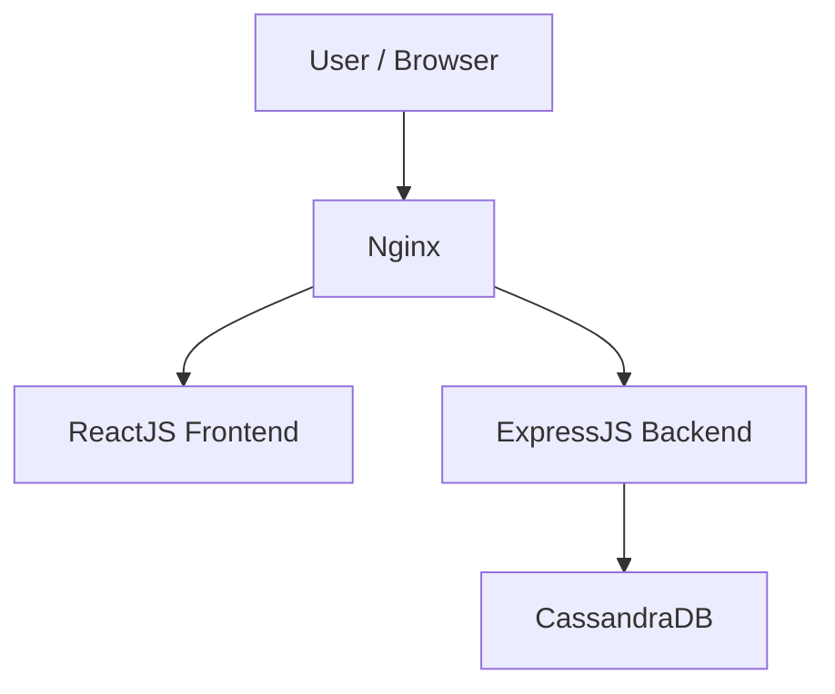
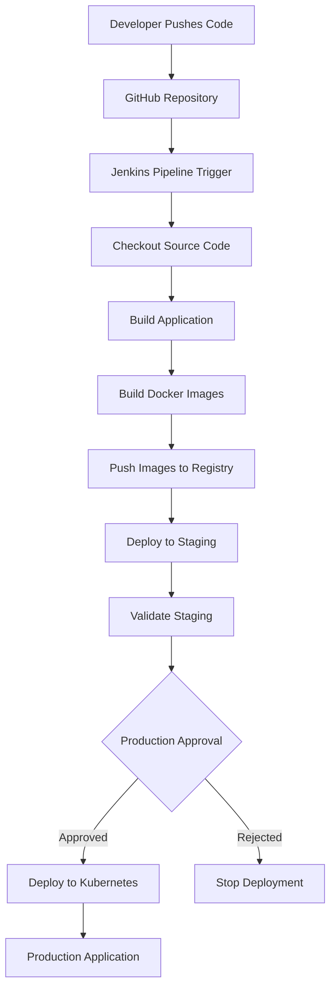

# Full-Stack Todo Application | DevOps Implementation

A full-stack Todo application built using **ReactJS, ExpressJS, and CassandraDB**, with a focus on implementing real-world DevOps practices.

This project demonstrates how a full-stack application can be developed, containerized, deployed, and managed across multiple environments — Development, Staging, and Production — using modern DevOps tools and technologies such as **Nginx, Docker, Kubernetes, AWS EC2, and Jenkins**.

The primary goal of this project is to understand and implement an end-to-end application deployment workflow, from local development to production deployment, while maintaining environment-specific configurations and deployment strategies.

---

## 🚀 Project Overview

The application provides a simple Todo management system with a ReactJS frontend, an ExpressJS backend, and CassandraDB for persistent data storage.

Alongside application development, this project focuses on building a multi-environment deployment architecture that reflects real-world software development and deployment workflows.

### Key Highlights

- Full-stack application development using ReactJS and ExpressJS.
- CassandraDB integration for persistent data storage.
- Environment-specific configurations for Development, Staging, and Production.
- Containerization of frontend, backend, and database services using Docker.
- Multi-container application orchestration using Docker Compose.
- Nginx configuration for reverse proxy and application traffic routing.
- Kubernetes-based application deployment and orchestration.
- Jenkins-based CI/CD pipeline implementation.
- AWS EC2 infrastructure for application deployment and hosting.

---

## 🛠️ Tech Stack

| Category | Technologies |
|---|---|
| Frontend | ReactJS, JavaScript |
| Backend | Node.js, ExpressJS |
| Database | Apache Cassandra |
| Reverse Proxy | Nginx |
| Containerization | Docker |
| Container Orchestration | Docker Compose, Kubernetes |
| CI/CD | Jenkins |
| Cloud Infrastructure | AWS EC2 |
| Version Control | Git, GitHub |

---

## 🏗️ Application Architecture

The application follows a three-tier architecture consisting of the frontend, backend, and database.



### Architecture Components

- **Frontend:** ReactJS provides the user interface for managing Todo items.
- **Backend:** ExpressJS exposes REST APIs and handles application logic.
- **Database:** CassandraDB stores Todo data persistently.
- **Nginx:** Acts as a reverse proxy to route incoming traffic to the appropriate application service.

---

## 🌍 Multi-Environment Setup

The application is deployed across three different environments, each representing a stage in the software development lifecycle.

### 1. Development Environment

The development environment is used for application development, debugging, and testing.

**Environment characteristics:**

- ReactJS frontend runs locally.
- ExpressJS backend runs locally.
- Application services are accessed through localhost.
- Developers can modify application code and verify changes directly.
- Environment-specific variables are configured using `.env.development`.

**Development workflow:**

```text
Developer
   |
   ├── ReactJS Frontend
   |      localhost
   |
   └── ExpressJS Backend
          localhost
              |
          CassandraDB
```

### 2. Staging Environment

The staging environment represents a production-like deployment environment used to validate application changes before releasing them to production.

**Environment characteristics:**

- Application services are containerized using Docker.
- Docker Compose manages the multi-container application.
- AWS EC2 is used as the hosting infrastructure.
- Nginx is configured as a reverse proxy.
- Frontend, backend, and database services communicate through the Docker network.
- Environment-specific configurations are managed using `.env.staging`.

**Staging architecture:**

```text
             AWS EC2 Instance
                   |
                 Nginx
                   |
            Docker Compose
                   |
       ┌───────────┼───────────┐
       |           |           |
   Frontend     Backend     CassandraDB
   Container    Container    Container
       |           |
       └───────────┘
```

This environment allows application changes to be validated in a containerized setup before they are deployed to production.

### 3. Production Environment

The production environment represents the deployment environment intended to serve the application.

**Environment characteristics:**

- Kubernetes is used for container orchestration.
- Frontend, backend, and database workloads run as Kubernetes resources.
- Kubernetes Services provide stable networking between application components.
- Nginx Ingress Controller manages external traffic routing.
- Persistent Volumes and Persistent Volume Claims are used for database storage.
- ConfigMaps and Secrets manage environment-specific configuration.
- Environment-specific settings are maintained separately from application code.

**Production architecture:**

```text
                User / Browser
                      |
                 Nginx Ingress
                      |
              Kubernetes Cluster
                      |
          ┌───────────┴───────────┐
          |                       |
   Frontend Service        Backend Service
          |                       |
   Frontend Pods             Backend Pods
                                  |
                           Cassandra Service
                                  |
                          Cassandra StatefulSet
                                  |
                            Persistent Storage
```

---

## 🔄 CI/CD Pipeline

Jenkins is used to automate the application build and deployment workflow.

The pipeline is designed to support the multi-environment deployment strategy, enabling application changes to move from development to staging and eventually to production.

### Pipeline Workflow



### CI/CD Stages

| Stage | Description |
|---|---|
| Source | Retrieve application code from GitHub |
| Build | Build frontend and backend applications |
| Containerization | Build Docker images for application services |
| Image Registry | Push versioned images to a container registry |
| Staging Deployment | Deploy the application to the staging environment |
| Validation | Verify application functionality in staging |
| Production Deployment | Deploy approved changes to the Kubernetes production environment |

The pipeline can be extended with automated tests, image scanning, manual approval gates, and rollback strategies.

---

## 🐳 Docker Implementation

Docker is used to containerize the application components.

### Docker Features

- Separate Dockerfiles for frontend and backend.
- Multi-stage Docker builds to optimize application images.
- Docker Compose for managing multi-container deployments.
- Docker networking for inter-container communication.
- Environment variables for application configuration.
- Persistent storage for CassandraDB.

### Docker Compose

The staging environment uses Docker Compose to manage the application services.

```bash
docker compose up -d --build
```

To stop the application:

```bash
docker compose down
```

---

## ☸️ Kubernetes Implementation

Kubernetes is used to deploy and manage the application in the production environment.

### Kubernetes Resources

| Resource | Purpose |
|---|---|
| Namespace | Isolate application resources |
| Deployment | Manage frontend and backend Pods |
| StatefulSet | Manage CassandraDB workload |
| Service | Provide stable networking |
| Ingress | Route external HTTP traffic |
| ConfigMap | Store non-sensitive configuration |
| Secret | Store sensitive configuration |
| PersistentVolume | Provide persistent storage |
| PersistentVolumeClaim | Request persistent storage |
| Nginx Ingress Controller | Handle external application traffic |

### Kubernetes Deployment

Apply the Kubernetes manifests:

```bash
kubectl apply -f k8s/
```

Check the deployed resources:

```bash
kubectl get pods
kubectl get deployments
kubectl get services
kubectl get ingress
```

Check application logs:

```bash
kubectl logs <pod-name>
```

---

## ⚙️ Environment Configuration

The application uses separate environment variables for different deployment environments.

| Environment | Frontend Configuration | Backend Configuration |
|---|---|---|
| Development | `.env.development` | `.env.development` |
| Staging | `.env.staging` | `.env.staging` |
| Production | `.env.production` | `.env.production` |

Environment variables are used to configure:

- API endpoints.
- CassandraDB connection details.
- Application ports.
- Database keyspace and table names.
- Environment-specific settings.

Sensitive configuration values should not be committed to the GitHub repository.

---

## 📂 Project Structure

The following is an example of the project structure. Adjust it according to your actual repository layout.

```text
.
├── frontend/
│   ├── src/
│   ├── public/
│   ├── Dockerfile
│   └── package.json
│
├── backend/
│   ├── src/
│   ├── Dockerfile
│   └── package.json
│
├── docker-compose.yml
│
├── nginx/
│   └── nginx.conf
│
├── k8s/
│   ├── namespace.yaml
│   ├── frontend-deployment.yaml
│   ├── frontend-service.yaml
│   ├── backend-deployment.yaml
│   ├── backend-service.yaml
│   ├── database-statefulset.yaml
│   ├── database-service.yaml
│   ├── ingress.yaml
│   ├── configmap.yaml
│   ├── secret.yaml
│   └── storage.yaml
│
├── Jenkinsfile
│
└── README.md
```

---

## 🎯 Project Objectives

The main objectives of this project are:

- Understand the complete lifecycle of a full-stack application.
- Implement a multi-environment deployment strategy.
- Learn Docker containerization and Docker Compose orchestration.
- Configure Nginx as a reverse proxy.
- Deploy and manage applications using Kubernetes.
- Implement persistent storage for CassandraDB in Kubernetes.
- Automate application deployment using Jenkins.
- Understand CI/CD pipeline design and environment promotion.
- Gain practical experience with AWS EC2 infrastructure.

---

## 📚 Learning Outcomes

Through this project, I aim to gain practical experience in:

- Full-stack application deployment.
- Containerization and container orchestration.
- Kubernetes networking and persistent storage.
- CI/CD pipeline automation.
- Environment-specific application configuration.
- Reverse proxy configuration.
- Cloud infrastructure management.
- Production-oriented DevOps practices.

---

## 🚧 Future Improvements

- Implement automated unit and integration testing.
- Add Docker image vulnerability scanning.
- Implement Kubernetes Horizontal Pod Autoscaling.
- Configure HTTPS using TLS certificates.
- Add monitoring and observability using Prometheus and Grafana.
- Implement automated rollback strategies.
- Introduce Infrastructure as Code using Terraform.
- Improve Kubernetes deployment strategies using rolling updates and health probes.

---

## 👨‍💻 Author

**Faiz Mohamed**

Full-Stack Developer | Aspiring DevOps Engineer

This project is part of my hands-on learning journey toward becoming a DevOps Engineer, focusing on building, deploying, and managing applications using modern DevOps tools and technologies.
